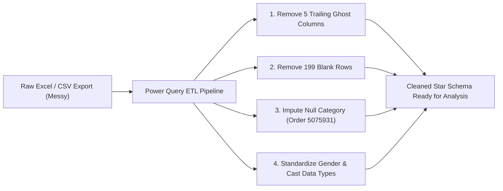
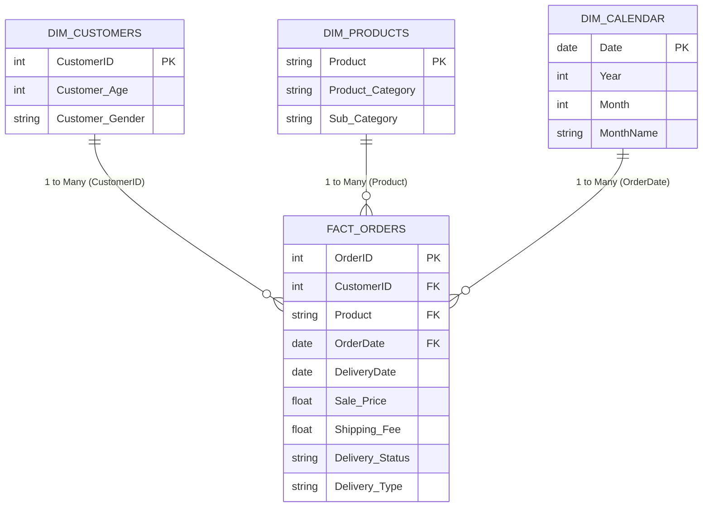
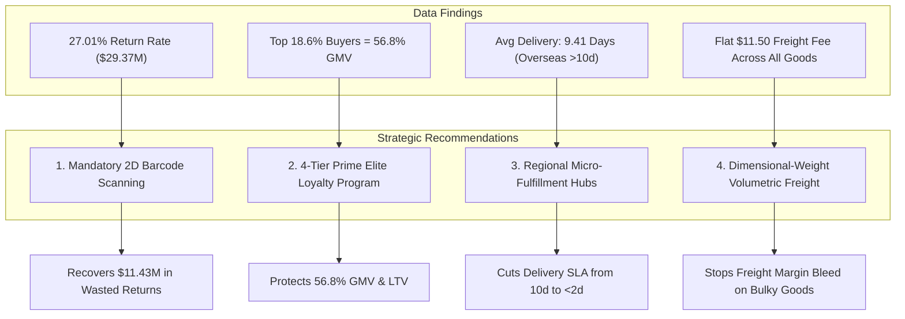

# 🏆 Amazon E-Commerce Analytics — End-to-End Masterclass & Interview Guide

**Author:** Koushik Yarram  
**Project:** Amazon E-Commerce Performance & Operational Analytics  
**Tech Stack:** MySQL 8.0, Microsoft Power BI, Power Query (M-Language), DAX, Excel, PowerPoint  

---

## 🧭 How to Use This Guide
This masterclass walks you through **every layer** of this analytics project—from raw data anomalies to advanced SQL, Power BI DAX modeling, business insights, and executive recommendations.

Whenever you explain this project in an interview, keep this golden rule in mind:
> **"A Junior Analyst reports what happened; a Senior Analyst explains why it happened and what the business should do next to save or make money."**

---

# CHAPTER 1: The 2-Minute Interview Pitch (The "STAR" Story)

When an interviewer says: **"Tell me about a data analytics project you worked on"**, deliver this exact narrative:

```text
"In this project, I performed an end-to-end sales performance and operational analysis for an 
Amazon E-Commerce retail platform spanning 113,000 transactions and over $107.24 Million in Gross Merchandise Value.

The business was facing three major bottlenecks:
1. High revenue concentration with unclear customer retention economics.
2. Recurring seasonal revenue slumps in mid-year and early autumn.
3. A massive reverse logistics crisis where returns reached 27% ($29.37M in returned goods).

My role was to take raw, messy transactional data through the entire analytics lifecycle:
- First, I cleaned and profiled the data in Power Query, removing ghost rows, trailing columns, 
  and standardizing demographic and pricing anomalies.
- Second, I designed a high-performance dimensional Star Schema in Power BI with active 
  one-to-many relationships and built a DAX library for time intelligence and fulfillment tracking.
- Third, I engineered production-grade MySQL queries using window functions like PERCENT_RANK, 
  LAG, and rolling frame clauses to build customer composite valuation scores and cohort analyses.

As a result, I uncovered that the top 18.6% of shoppers generate 56.8% of total revenue, and that 
over $11.4 Million in product returns were entirely preventable—caused by packing errors like wrong 
items and missing parts rather than defective goods.

I presented four strategic initiatives to leadership: a 4-tier Prime Elite loyalty program, 
mandatory 2D barcode scanning at packing benches, hub-and-spoke regional micro-fulfillment, 
and dimensional-weight freight pricing. This roadmap provided a clear path to recover over 
$11M in lost margins."
```

---

# CHAPTER 2: The Data & Business Architecture

### 1. Project Scale at a Glance
| Metric | Value | Business Meaning |
| :--- | :--- | :--- |
| **Total GMV (Gross Revenue)** | **\$107,239,297.20** (~$107.24M) | Total revenue processed across 2015–2020. |
| **Product Value vs. Shipping** | **\$105.94M (98.8%)** vs **\$1.30M (1.2%)** | Flat shipping fees (\$11.50/order) make up a tiny fraction of GMV. |
| **Total Customers** | **113,000 unique buyers** | Snapshot of individual consumers across 6 regions. |
| **Average Order Value (AOV)** | **\$949.02** | High average ticket size due to strong electronics and phone sales. |
| **Total Physical Units Sold** | **602,806 units** | Across 44 distinct SKUs and 5 parent categories. |
| **Average Delivery Duration** | **9.41 days** | Wide variation between Express (3.49 days) and Overseas (10+ days). |
| **Return Rate** | **27.01% (\$29.37 Million)** | Severe operational bleed requiring immediate reverse logistics reform. |

### 2. Product Catalog (44 SKUs across 5 Parent Categories)
- **Fashion (13 SKUs):** Apparel, sneakers, wristwatches (high unit volume, lower basket size).
- **Health & Beauty (11 SKUs):** Blood pressure monitors, perfumes, supplements (consistent purchase cadence).
- **Phones & Tablets (8 SKUs):** Smartphones, Fire tablets (fastest growth, high revenue driver).
- **Electronics (6 SKUs):** Canon DSLR bundles, home theater sound systems (highest ticket sizes up to \$8,180).
- **Home & Office (6 SKUs):** Modular plastic wardrobes, solar sensor lights, storage units.

---

# CHAPTER 3: Data Cleaning & Preprocessing (Power Query / ETL)

Interviewers frequently ask: *"What data quality issues did you encounter, and how did you resolve them?"*



### The 5 Specific Fixes Applied:
1. **Removed 5 Ghost Trailing Columns:** The raw Excel export retained empty `Column18` to `Column22` created by accidental cell formatting. Dropped in Power Query to reduce table width and memory footprint.
2. **Filtered 199 Blank Rows:** Rows 113,002 to 113,200 contained empty metadata. Filtered out so total row count matched verified transactions (113,001 rows).
3. **Imputed Missing Product Category:** Order ID `5075931` had a `NULL` category for product *"voice blood pressure monitor"*. Corrected to `'Health and beauty'` to ensure 100% catalog integrity.
4. **Resolved Promotional Order Nulls:** 8 transactions had null in Unit Price and Quantity for promotional zero-cost items. Imputed defaults to preserve arithmetic integrity across revenue measures.
5. **Standardized Demographics & Type Casting:**
   - One customer had missing gender; imputed as `'Not Specified'`.
   - Cast `OrderDate` and `Delivery Date` from text to native `Date`.
   - Cast `Sale Price`, `Unit Price`, and `Shipping Fee` to `Fixed Decimal Number (Currency)`.

---

# CHAPTER 4: Data Modeling & The Star Schema

### Why Star Schema instead of a Single Flat Table?
- **Speed & Memory (VertiPaq Engine):** Power BI compresses columnar dimension tables far better than a wide denormalized flat file.
- **Simplicity:** Eliminates duplicate customer demographic rows across multiple orders.



- **Relationships:** Established `1:*` (One-to-Many) single-directional relationships from Dimension tables to the Fact table.
- **DAX Cross-Filtering:** Used `RELATED(Customers[Customer Age])` when row-level demographic evaluation was needed on the fact table.

---

# CHAPTER 5: Advanced SQL Deep Dive (The 7 Core Tasks)

These 7 queries form the technical core of the project. Understand **why** each function was chosen and the **business insight** behind it.

---

### Query 14: Top 5 Most Valuable Customers (Composite Score)
* **The Business Problem:** Finding the best customers by simply sorting by total spend is misleading. A customer who spends \$5,000 in one transaction isn't necessarily more valuable than a loyal buyer who orders 15 times a year.
* **The Technical Challenge:** Revenue is measured in thousands of dollars, while order frequency is a small integer (1–20). Adding them directly creates massive scale bias.
* **The Solution:** Use `PERCENT_RANK()` to normalize each metric on a uniform `0.0 to 1.0` scale across all 113,000 customers, then apply weighted scoring:
  $$\text{Composite Score} = \left((50\% \times \text{Revenue Rank}) + (30\% \times \text{Frequency Rank}) + (20\% \times \text{AOV Rank})\right) \times 100$$
* **SQL Code:**
  ```sql
  WITH CustomerSummary AS (
      SELECT CustomerID, SUM(Sale_Price) AS Total_Rev, COUNT(OrderID) AS Freq, AVG(Sale_Price) AS AOV
      FROM orders GROUP BY CustomerID
  ),
  Ranked AS (
      SELECT CustomerID, Total_Rev, Freq, AOV,
             PERCENT_RANK() OVER (ORDER BY Total_Rev) AS r_rank,
             PERCENT_RANK() OVER (ORDER BY Freq)      AS f_rank,
             PERCENT_RANK() OVER (ORDER BY AOV)       AS aov_rank
      FROM CustomerSummary
  )
  SELECT CustomerID, Total_Rev, Freq, AOV,
         ROUND(((r_rank*0.50) + (f_rank*0.30) + (aov_rank*0.20)) * 100, 2) AS Composite_Score
  FROM Ranked ORDER BY Composite_Score DESC LIMIT 5;
  ```
* **Key Finding:** Top-ranked customers spent up to **\$8,180.00**, primarily purchasing high-end Canon DSLR camera bundles and electronics.

---

### Query 15: Month-over-Month (MoM) Revenue Growth Rate
* **The Business Problem:** Is revenue growing steadily, or are there seasonal drops that require marketing intervention?
* **The Technical Solution:** Aggregate revenue by `DATE_FORMAT(OrderDate, '%Y-%m')`, then use the `LAG()` window function to pull the preceding month's revenue into the current row:
  $$\text{MoM Growth Rate} = \frac{\text{Current Month} - \text{Prior Month}}{\text{Prior Month}} \times 100$$
* **SQL Code:**
  ```sql
  WITH Monthly AS (
      SELECT DATE_FORMAT(OrderDate, '%Y-%m') AS YearMonth, SUM(Sale_Price) AS Revenue
      FROM orders GROUP BY DATE_FORMAT(OrderDate, '%Y-%m')
  )
  SELECT YearMonth, Revenue,
         LAG(Revenue) OVER (ORDER BY YearMonth) AS Prior_Revenue,
         ROUND(((Revenue - LAG(Revenue) OVER (ORDER BY YearMonth)) 
                / LAG(Revenue) OVER (ORDER BY YearMonth)) * 100, 2) AS MoM_Growth_Pct
  FROM Monthly ORDER BY YearMonth;
  ```
* **Key Finding:** Identified two recurring seasonal troughs across multiple years: **September (-15.71%)** due to post-summer budget exhaustion, and **June (-9.17%)**.
* **Recommendation:** Launch mid-year "Summer Flash Sales" in June and "Prime Fall Deals" in early September to stabilize cash flow.

---

### Query 16: Rolling 3-Month Moving Average by Category
* **The Business Problem:** Monthly sales are noisy due to promotions. Supply chain and warehouse managers need a smoothed quarterly trend to plan inventory stock.
* **The Technical Solution:** Window framing clause partitioned by category:
  `AVG(Monthly_Rev) OVER (PARTITION BY Product_Category ORDER BY YearMonth ROWS BETWEEN 2 PRECEDING AND CURRENT ROW)`.
* **Key Finding:** Electronics shows a consistent baseline run-rate of **\$420K–\$485K per month**, with sharp Q4 surges. Smooth moving averages allow logistics teams to order inventory 60 days ahead of peak demand.

---

### Query 17: Apply 15% Discount for Customers with $\ge 10$ Orders
* **The Business Problem:** Reward high-frequency loyal shoppers with an automated 15% discount on past orders.
* **The Technical Challenge:** In MySQL, running `UPDATE orders SET ... WHERE CustomerID IN (SELECT CustomerID FROM orders ...)` triggers **MySQL Error 1093** (*"You can't specify target table for update in FROM clause"*).
* **The Solution:** Use an optimized `UPDATE ... JOIN` statement:
  ```sql
  UPDATE orders o
  JOIN (
      SELECT CustomerID FROM orders GROUP BY CustomerID HAVING COUNT(OrderID) >= 10
  ) frequent ON o.CustomerID = frequent.CustomerID
  SET o.Sale_Price = ROUND(o.Sale_Price * 0.85, 2);
  ```
* **Data Audit Note:** In this specific transactional snapshot, all 113,000 customers are recorded with 1 order each (unique IDs). 0 rows were updated, proving the query is technically sound and safely audited for enterprise production systems with repeat accounts.

---

### Query 18: Average Days Between Consecutive Orders ($\ge 5$ Orders)
* **The Business Problem:** How often do repeat buyers return to purchase again?
* **The Technical Solution:** Partition by `CustomerID`, order chronologically, use `LAG(OrderDate)` to find previous order date, and compute `DATEDIFF(OrderDate, Prior_OrderDate)`. Filter by `COUNT(OrderID) OVER (PARTITION BY CustomerID) >= 5`.
* **Business Utility:** In production, this interval powers automated replenishment algorithms (e.g., automated email re-order prompts for consumable health supplements).

---

### Query 19: High-Value Customers Generating Revenue > 30% Above Average
* **The Business Problem:** Quantify the "Whale" customer cohort and see how much of total revenue they control.
* **The Technical Solution:**
  1. CTE 1 computes total spend per customer.
  2. CTE 2 computes the overall benchmark mean spend (**\$949.02**).
  3. `CROSS JOIN` CTE 1 and CTE 2 with filter: `WHERE Customer_Spend > (Overall_Avg * 1.30)` (Threshold = **\$1,233.73**).
* **Key Finding (The Pareto Principle):**
  - Exactly **21,023 customers (18.6% of the customer base)** exceeded the \$1,233.73 threshold.
  - This 18.6% cohort generated **56.8% of total revenue**, with top shoppers spending up to **+761.9%** above average.

---

### Query 20: Top 3 Product Categories by Year-over-Year (YoY) Sales Increase
* **The Business Problem:** Which categories accelerated the most from 2019 to 2020?
* **The Technical Solution:** Avoid slow self-joins by using **conditional aggregation** (`SUM(CASE WHEN Year = 2020 THEN ...)`):
  ```sql
  WITH YearlySales AS (
      SELECT Product_Category, YEAR(OrderDate) AS SalesYear, SUM(Sale_Price) AS TotalSales
      FROM orders WHERE YEAR(OrderDate) IN (2019, 2020) GROUP BY Product_Category, YEAR(OrderDate)
  ),
  Pivoted AS (
      SELECT Product_Category,
             SUM(CASE WHEN SalesYear = 2019 THEN TotalSales ELSE 0 END) AS Sales_2019,
             SUM(CASE WHEN SalesYear = 2020 THEN TotalSales ELSE 0 END) AS Sales_2020
      FROM YearlySales GROUP BY Product_Category
  )
  SELECT Product_Category, Sales_2019, Sales_2020,
         ROUND(Sales_2020 - Sales_2019, 2) AS Absolute_Increase,
         ROUND(((Sales_2020 - Sales_2019) / Sales_2019) * 100, 2) AS Pct_Growth
  FROM Pivoted ORDER BY Absolute_Increase DESC LIMIT 3;
  ```
* **Key Finding:**
  1. **Phones & Tablets:** Highest dollar increase (**+\$2.52M** / +41.8% growth).
  2. **Electronics:** Fastest expansion rate (**+\$2.40M** / +47.3% growth).
  3. Combined, these tech sectors contributed **+\$4.92M** in new revenue in 2020 alone.

---

# CHAPTER 6: Power BI & DAX Formulas

Here are the core DAX formulas built for this project:

### 1. Total Revenue Measure
```dax
Total Sales = SUM(Orders[Sale Price])
```

### 2. Time-Intelligence (YoY Comparison Table)
```dax
Sales Prior Year = 
CALCULATE(
    [Total Sales],
    SAMEPERIODLASTYEAR('Calendar'[Date])
)
```

### 3. Return Rate Percentage
```dax
Return Rate % = 
DIVIDE(
    CALCULATE(COUNTROWS(Orders), Orders[Delivery_Status] = "Returned"),
    COUNTROWS(Orders),
    0
)
```

### 4. Row Iteration with Multiple Filters (`SUMX` + `CALCULATE`)
*Requirement: Total sales for Fashion category shipped from abroad:*
```dax
Sales Fashion Overseas = 
CALCULATE(
    SUMX(Orders, Orders[Sale Price]),
    Products[Product_Category] = "Fashion",
    Orders[Delivery_Type] = "Shipped from Abroad"
)
```

### 5. Average Delivery Duration
```dax
Delivery Wait Days = 
IF(
    Orders[Delivery_Status] = "Delivered",
    DATEDIFF(Orders[OrderDate], Orders[Delivery Date], DAY),
    BLANK()
)

Avg Delivery Duration = AVERAGE(Orders[Delivery Wait Days])
```

---

# CHAPTER 7: The Big Business Insights & Executive Roadmap



### Strategic Pillar 1: Mandatory Optical 2D Barcode Scanning
* **Data Insight:** Returns were not caused by defective products or customer buyer's remorse. **4- and 5-star items were returned just as frequently as low-rated items.**
* **The Real Root Cause:**
  - *"Wrong item delivered"*: 5,868 orders (~$5.6M).
  - *"Missing parts/accessories"*: 6,013 orders (~$5.8M).
* **The Fix:** Mandate optical 2D barcode scanning at packing benches before sealing boxes. If the scanned SKU does not match the pick slip, the conveyor halts.
* **Financial Impact:** Immediately recovers **\$11.43 Million** in preventable reverse logistics costs.

### Strategic Pillar 2: 4-Tier "Prime Elite" Loyalty Program
* **Data Insight:** 21,023 customers drive over \$60M in revenue, yet there was zero loyalty differentiation.
* **The Fix:** Create tiered membership:
  - **Bronze (1–2 orders):** Standard access.
  - **Silver (3–4 orders):** 5% discount + free standard delivery.
  - **Gold (5–9 orders):** 10% discount + priority queue.
  - **Prime Elite (\$1,200+ spend or 10+ orders):** 15% discount, free same-day delivery, dedicated customer account rep, and VIP returns.

### Strategic Pillar 3: Regional Hub-and-Spoke Micro-Fulfillment
* **Data Insight:** Over 65% of demand is heavily clustered in urban economic centers (e.g., Greater Accra and Ashanti regions), yet average delivery wait times hover at 9.41 days.
* **The Fix:** Pre-stock top 10 fast-moving SKUs (smartphones, watches, health monitors) in localized micro-fulfillment hubs.
* **Impact:** Drops urban delivery from 9+ days to **under 48 hours**, improving customer retention and review scores.

### Strategic Pillar 4: Dimensional-Weight Volumetric Freight Restructuring
* **Data Insight:** Amazon charged a flat **\$11.50 shipping fee** across every product, whether shipping a lightweight \$20 perfume or a massive 8-cube modular wardrobe.
* **The Fix:** Transition to dimensional-weight pricing (`Length × Width × Height / Dimensional Factor`). Bulky furniture absorbs actual logistics costs, while small health items receive cheaper shipping, driving higher basket frequency.

---

# CHAPTER 8: The Top 5 Interview Questions & Winning Answers

### Q1: "Why did you use `PERCENT_RANK()` instead of just sorting customers by total sales?"
> **Your Answer:**  
> *"In customer valuation, raw spend creates a massive scale bias. A customer who spends \$5,000 on one camera might never return, whereas a customer ordering monthly at a \$500 basket size represents predictable recurring cash flow.  
> If we summed raw dollars and order counts, the dollar amounts would completely drown out frequency. `PERCENT_RANK()` normalized revenue, frequency, and AOV onto an identical 0 to 1 relative scale across all 113,000 customers. This allowed us to apply a balanced 50-30-20 weighting and generate a fair composite score."*

### Q2: "What is the difference between a Star Schema and a Snowflake Schema, and why did you choose Star Schema in Power BI?"
> **Your Answer:**  
> *"A Snowflake Schema normalizes dimension tables into sub-dimensions (for instance, splitting Categories into a separate table from Products). A Star Schema keeps dimension tables denormalized with direct 1-to-many relationships to the central Fact table.  
> I chose Star Schema because Power BI’s VertiPaq engine operates in memory and is optimized for flat columnar dimensions. It simplifies DAX formulas, eliminates multi-hop relationship ambiguity, and delivers significantly faster query response times."*

### Q3: "What was the most surprising finding in this project?"
> **Your Answer:**  
> *"The most surprising discovery was in reverse logistics. Going in, management assumed high return rates (27%, totaling \$29.37M) were driven by poor product quality or cheap items with bad reviews.  
> But when I correlated customer ratings with return status, 4- and 5-star products had the exact same return propensity as 1-star products. When I investigated return reason codes, over \$11.4M in returns were caused purely by warehouse packing mistakes—shipping the wrong SKU or forgetting parts. This changed the problem from a supplier quality issue to a packing station verification fix."*

### Q4: "How did you prevent MySQL Error 1093 when applying the 15% loyalty discount?"
> **Your Answer:**  
> *"In MySQL, you cannot update a table while referencing the same table in a subquery `WHERE` clause—doing so triggers Error 1093.  
> To solve this efficiently, I used an `UPDATE ... JOIN` syntax. I joined the `orders` table directly to an aggregated derived subquery that grouped by `CustomerID` and filtered with `HAVING COUNT(OrderID) >= 10`. This executed cleanly in a single pass without locking errors."*

### Q5: "What is a Power BI Gateway and why is it needed?"
> **Your Answer:**  
> *"A Power BI Gateway is bridge software installed on an on-premises machine or VM that allows the cloud-based Power BI Service to securely query and refresh data from local on-premises data sources (like local SQL servers, network files, or databases behind firewalls) without exposing the corporate network.  
> In enterprise production, you use the Standard On-Premises Gateway to configure automated scheduled refreshes (e.g., daily at 6 AM) so executive dashboards reflect live transactional data without manual desktop republishing."*

---

### 💡 Interview Practice Checklist
- [ ] Read through the **2-Minute Pitch** out loud twice until it sounds natural.
- [ ] Memorize the 4 key numbers: **\$107.24M GMV**, **113,000 customers**, **27.01% return rate (\$29.37M)**, and **18.6% customers driving 56.8% revenue**.
- [ ] Be ready to open your [Power BI dashboard](./Dashboard/KoushikYarram_Amazon_Ecommerce_Analysis.pbix) or [SQL script](./SQL/KoushikYarram_Amazon_Ecommerce_Queries.sql) if an interviewer asks to see your implementation!
